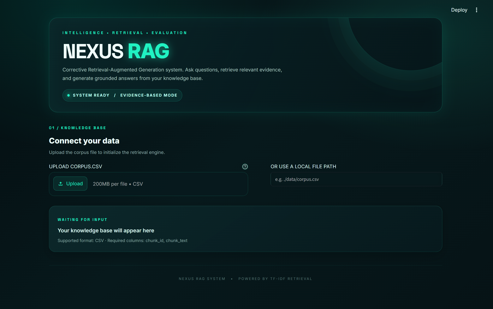
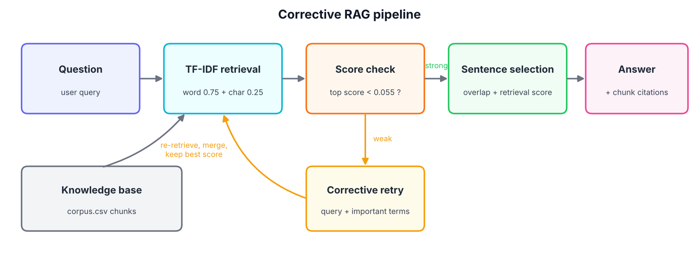

# 🔎 Corrective RAG System: Grounded Question Answering with Citations


A **Retrieval-Augmented Generation (RAG)** baseline built with classic NLP tools (no LLM, no API key). It retrieves the most relevant chunks from a knowledge base, **retries with a broadened query when the first retrieval is weak** (the "corrective" step), and builds an **extractive answer with chunk citations**, so every sentence in the answer comes from retrieved evidence. A Streamlit app lets you ask questions interactively.

Built for the Kaggle competition **AgentEval Part I: Grounded RAG Benchmark**.

---

## 🌐 Links

- 📓 **Notebook on Kaggle:** [corrective-rag-system](https://www.kaggle.com/code/abdelazizelshourbgy/corrective-rag-system)
- 🏁 **Competition data:** [AgentEval Part I: Grounded RAG Benchmark](https://www.kaggle.com/competitions/agent-eval-part-i-grounded-rag-benchmark/data)
- 🚀 **Streamlit demo:** [corrective-rag-system](https://corrective-rag-project.streamlit.app/)

## 📸 Demo

### Live app (Streamlit)




https://github.com/user-attachments/assets/eafc5fc8-6f81-4731-9047-3663b7bbf0ae


## 🧭 Pipeline at a glance



---

## ✨ Features

- Word + character TF-IDF retrieval over pre-chunked documents
- **Corrective retrieval:** if the best score is below a threshold, the query is expanded with its important terms and retrieved again, then both result sets are merged by best score
- **Grounded extractive answers:** sentences are selected from retrieved chunks, never generated
- **Citations:** every answer returns the chunk IDs it came from
- Retrieval evaluation on the labeled training set (Recall@K, MRR, Precision@K)
- Generates a Kaggle-ready `submission.csv` (`question_id`, `answer`, `cited_chunk_ids`)
- Streamlit app showing the answer, sources, whether the retry fired, and the retrieved evidence

## 🗂️ Dataset

[AgentEval Part I: Grounded RAG Benchmark](https://www.kaggle.com/competitions/agent-eval-part-i-grounded-rag-benchmark/data). Please check the competition page for its rules and terms of use.

| File | Rows | Columns |
|---|---|---|
| `corpus.csv` | 3,600 chunks | `chunk_id`, `doc_id`, `title`, `doc_type`, `chunk_text` |
| `train.csv` | 2,200 questions | `question_id`, `question`, `answer`, `gold_chunk_ids` |
| `test.csv` | 800 questions | `question_id`, `question` |
| `sample_submission.csv` | | `question_id`, `answer`, `cited_chunk_ids` |

The benchmark provides **pre-chunked text**, not the original documents, so the notebook starts directly from `corpus.csv`.

## 🧪 Method

**1. Prepare the knowledge base**

Each chunk is indexed as `title + doc_type + chunk_text`, so document metadata helps matching. Duplicate `chunk_id`s are dropped.

**2. Retrieve**

| Setting | Value |
|---|---|
| Word TF-IDF | 1-2 grams, English stop words, sublinear TF |
| Character TF-IDF | `char_wb`, 3-5 grams, sublinear TF |
| Combined score | `0.75 × word similarity + 0.25 × character similarity` (cosine) |
| Default top-K | 5 |

Word features match technical terms; character features help with IDs, spelling variants and partial terms. On this corpus the index has 946 word features and 4,376 character features.

**3. Correct**

If the best score is below **0.055**, the query is expanded with its important terms (up to 10, stop words removed) and retrieved again. Results from both passes are merged, keeping each chunk's best score.

**4. Answer**

Sentences from the retrieved chunks are scored with `0.65 × retrieval score + 0.35 × term overlap with the question`. The answer is made of the top sentences (up to 3), and citations list the chunks they came from (up to 2). If nothing relevant is found, the system says so instead of guessing.

---

## 📊 Results

Retrieval quality on the **first 300 labeled training questions** (`k = 5`):

| Metric | Score |
|---|---|
| Recall@5 | 0.408 |
| MRR | 0.294 |
| Precision@5 | 0.107 |

How to read these numbers:

- Most questions have a single gold chunk, so **Precision@5 can never exceed 0.2** for them. Recall@5 and MRR are the more informative metrics here.
- These are retrieval diagnostics on a sample, **not the official competition score** and not a claim of leaderboard performance.
- The notebook produces `submission.csv` with 800 rows for the test set.

### Example

For the training question *"Answer using evidence. What is the correct key detail from 'Security advisory: credential stuffing patterns' (ignore unrelated notes)?"* the system retrieved the matching advisory chunk first and returned it as the answer with its citation (`doc_0893_chunk_3`).

### Observations

- The corpus contains **many chunks with identical text under different `doc_id`s**. They get exactly the same score, so choosing which copy to cite is close to arbitrary. This likely caps Recall and MRR regardless of how good the ranking is.
- Some questions ask for a different chunk of the same document than the one ranked first, so a correct document does not always mean a correct chunk.

---

## 📁 Project structure

```
corrective-rag-project/
├── corrective-rag-system.ipynb   # notebook: load, index, retrieve, answer, evaluate, submit
├── app.py                        # Streamlit interface
├── requirements.txt
├── assets/
│   └── Overview.png
│   └── pipeline.png              # pipeline diagram
├── LICENSE
└── README.md
```

The notebook writes `submission.csv` to `/kaggle/working`. The Streamlit app is separate and is **not** exported by the notebook. It uses the same retrieval and answer-selection logic as the notebook.

## 🚀 Run it

### On Kaggle (recommended)

1. Open the [notebook](https://www.kaggle.com/code/abdelazizelshourbgy/corrective-rag-system) and click **Copy & Edit**.
2. Click **Add Input** and make sure **AgentEval Part I: Grounded RAG Benchmark** is attached.
3. Press **Run All**. A GPU is not needed.

The notebook finds the CSV files by searching `/kaggle/input` recursively, so the exact input folder name does not matter. To evaluate on all 2,200 training questions instead of 300, set `limit=None` in the evaluation cell.

### Locally (Streamlit app)

```bash
git clone https://github.com/AbdelazizElshourbgy-ui/corrective-rag-system.git
cd corrective-rag-project

python -m venv venv
venv\Scripts\activate        # Windows
# source venv/bin/activate   # macOS / Linux

pip install -r requirements.txt
streamlit run app.py
```

Upload `corpus.csv` in the app (or type its path), ask a question, and choose how many chunks to retrieve (1 to 10). The app shows the answer, its sources, whether the corrective retry fired, the initial retrieval score, and the evidence chunks.

> Kaggle notebooks do not expose a Streamlit port automatically, so run the app locally.

## ⚠️ Limitations

- Retrieval is lexical (TF-IDF). It has no semantic understanding, so paraphrased questions can be missed.
- Answers are **extractive**: they are whole or partial sentences copied from chunks, not synthesized across sources.
- The corrective step only broadens the query. There is no relevance grader or fallback source, and it fires only when the best score is below 0.055. In the examples inspected the first score was far above that, so how often the retry triggers on the full data has not been measured.
- Evaluation covers retrieval only. There is no answer-level metric (for example token F1 against the reference answers) and no ablation with and without the retry.
- Retrieval metrics were computed on 300 of the 2,200 training questions.
- Duplicate chunks across documents limit the achievable score (see Observations).

## 🔮 Future work

- Measure how often the corrective retry triggers, and compare results with and without it
- Add answer-level metrics (token F1, citation precision and recall)
- Break ties between identical chunks using document-level signals
- Add a dense or hybrid retriever and a cross-encoder reranker
- Add a relevance grader that decides whether to retry, expand, or abstain
- Add an ingestion and chunking stage for raw documents

## 🛠️ Tech stack

Python · scikit-learn · NumPy · pandas · Streamlit · Kaggle

## 👤 Author

**Abdelaziz Elshourbgy**

GitHub: [@AbdelazizElshourbgy-ui](https://github.com/AbdelazizElshourbgy-ui) · LinkedIn: [Abdelaziz Elshourbgy](https://www.linkedin.com/in/abdelaziz-elshourbgy-b126a83a2/)

## 📄 License

Code released under the [MIT License](LICENSE). The dataset belongs to its original authors; see the competition page for its terms.
